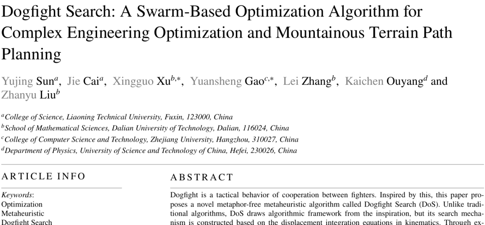
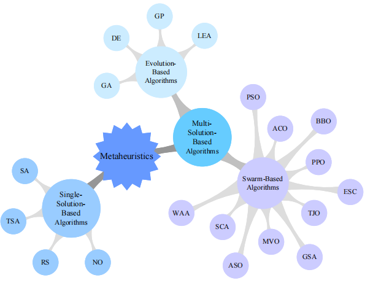
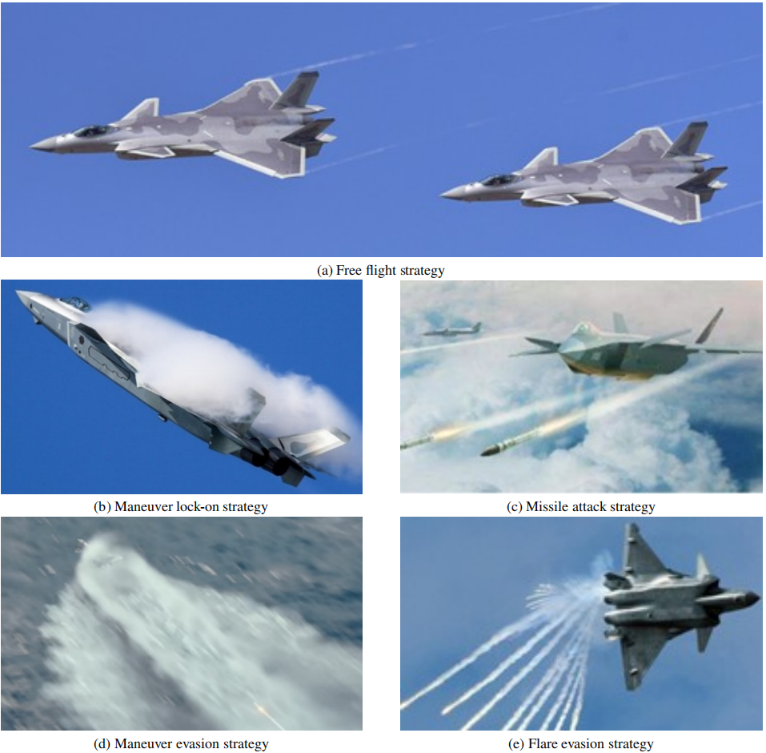
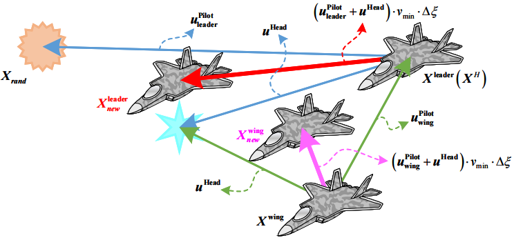
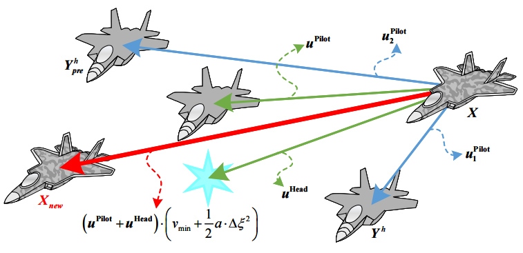
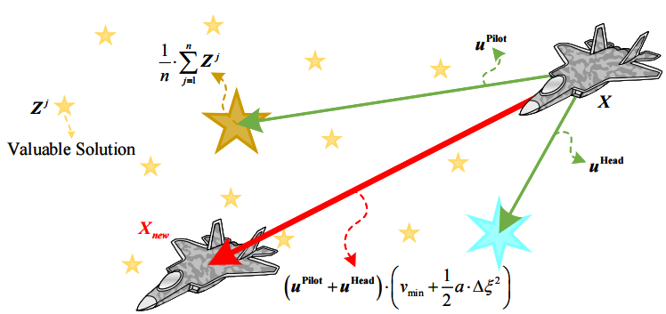
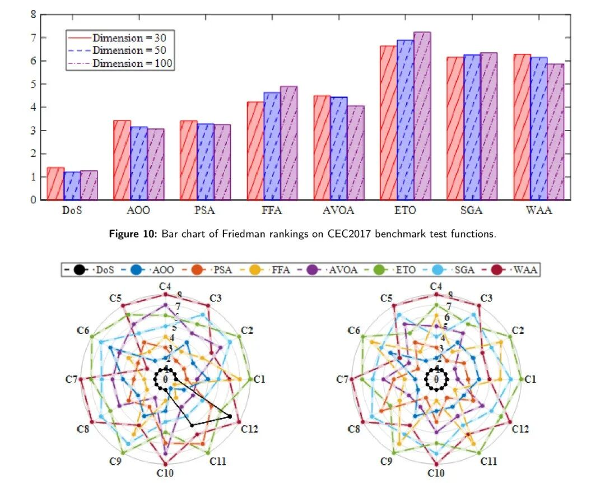
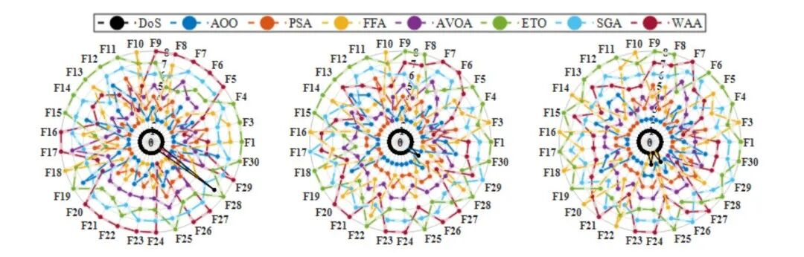
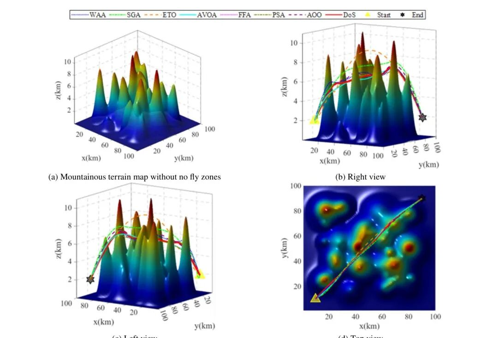
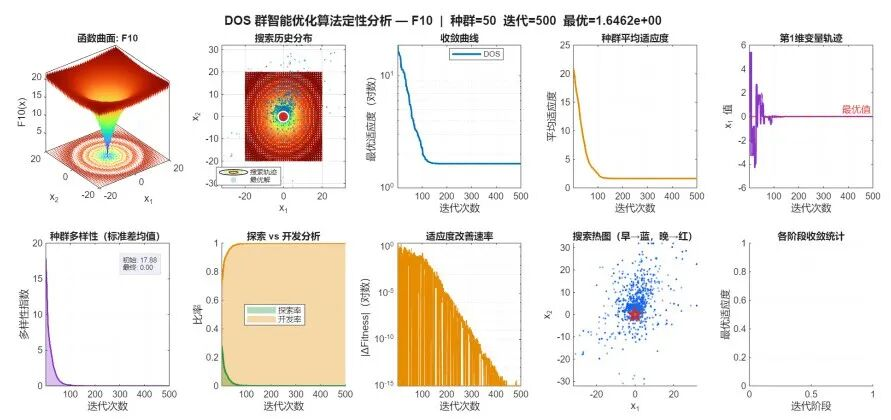

# New algorithm for 2026! Optimization of dogfight in air combat with DOS, search distribution graphs, population diversity, and exploration development analysis.

Operating Platform: MATLAB R2023a and above
The literature review draws inspiration from the dogfighting behavior of fighter jets, with Sun Y, Cai J, Xu X et al. proposing a novel metaheuristic optimization algorithm in March 2026, named Dogfight Search (DoS), which is published in arXiv:2603.28046.
This algorithm has not been officially published yet, let alone used by others. Whoever uses it first becomes innovative. The point you use this is yours.
I. Research Motivation and Problem Background
Most existing metaheuristic optimization algorithms draw inspiration from biological group behaviors, including wolf packs, whale schools, bird flocks, etc., creating a series of biomimetic paradigms. However, there is a common issue with these algorithms—the search mechanism is highly homogenized, with little difference in mathematical framework among different algorithms, essentially just changing metaphors.
The following diagram is a taxonomy map of metaheuristic algorithms, DoS belongs to the uniconceptual mathematically driven type within the group intelligence algorithms:
The starting point of DoS is to break out of this dilemma. Its inspiration comes from the attack and avoidance behaviors in air combat: during the attack phase, emphasis is on locking onto and pursuing targets, corresponding to local development in optimization; during the avoidance phase, emphasis is on maneuverability and escape, corresponding to global exploration. The alternating operation of these tactics naturally fits the optimization algorithm's need for balancing exploration and exploitation.
More importantly, DoS does not stop at behavioral imitation. Its search mechanism is based on displacement integral equations in kinematics, belonging to an uniconceptual mathematically driven algorithm, with a more solid theoretical foundation.
II. Algorithm Principles and Mathematical Modeling
This paper provides a complete qualitative and quantitative analysis of the DoS algorithm, covering aspects such as three-dimensional fitness landscape, search history distribution, semi-logarithmic convergence curve, population diversity change, and dynamic exploration/exploitation ratio. These help readers understand the algorithm's search behavior and convergence characteristics intuitively. The relevant analysis results will be presented later.
2.1 The dual-team combat design of DoS divides the population into two teams: a stealth fighter team and a conventional fighter team. These two teams are in a combat relationship within the search space, initialized in different subspaces. This design draws on the strategy of partitioning search by red and blue forces in military exercises, effectively enhancing the diversity of the initial population stage.
2.2 The displacement integral update mechanism follows the following displacement integral equation for five search strategies:
Where u represents the direction vector, determining the search direction; v represents the flight speed, controlling the step size; Δt represents the flight duration. Different strategies achieve diverse search behaviors through the differentiated definition of these three parameters.
2.3 The direction vector is decomposed into two components:
Where u_Pilot is determined by internal information (the position of the lead aircraft) to reflect local guidance; u_Head is determined by global high-quality solutions to provide global information. The synergy between the two ensures that individuals can utilize local information for fine-grained searches while avoiding local optima with global information.
2.4 In the free flight mode, the lead aircraft performs random searches, while the follower aircraft moves according to its leader, suitable for extensive exploration at the beginning: The figure shows the dynamic selection mechanism of the follower aircraft, demonstrating how it adapts to search strategies based on performance.
In maneuver lock mode, the search direction points towards the optimal position of the enemy team, with strong convergence, suitable for later fine optimization:
In missile attack mode, the step size is further strengthened based on locking, introducing an acceleration factor:
In maneuver avoidance mode, contrary to locking, the direction deviates from the optimal position of the enemy, helping to escape from the current area:
In decoy bomb avoidance mode, random perturbations are introduced to simulate the tactic of releasing decoy bombs in air warfare, helping to escape from local traps:
The detailed illustration of missile attack and decoy bomb avoidance strategies:
The coordinated operation of the above five strategies allows DoS to achieve a dynamic balance between exploration breadth and development depth.
III. Performance Validation and Comparative Analysis
This paper systematically evaluates DoS on the CEC2017 and CEC2022 standard test sets, comparing it with seven mainstream algorithms including PSO, GWO, WOA, HHO, RUN, MPA, and PO. Additionally, it contrasts with the current state-of-the-art algorithms LSHADE-SPACMA and EA4eig, as well as MadDE. The Friedman rank test results show that DoS ranks first in both test sets, significantly outperforming all other comparisons.
The experimental results are shown in the following figure:
Friedman average ranking and radar chart intuitively demonstrate the comprehensive advantages of DoS:
Shows the actual moving path of DoS within the search space:
To further visually illustrate the algorithm's search behavior, a complete qualitative analysis based on the F10(Ackley) function is presented, covering aspects such as convergence curves, search history distribution, population diversity changes, and dynamic exploration-exploitation ratio:
IV. Code Access
We will periodically post innovative, high-quality learning materials, articles, and code to support your research endeavors!

## Images

<!-- PAYMENT_BLOCK -->

## Get this dataset

- Payment link (Stripe): [Buy now](https://buy.stripe.com/3cs8yP7sY87d0vu9AB)
- Payment QR code: 

<!-- /PAYMENT_BLOCK -->
